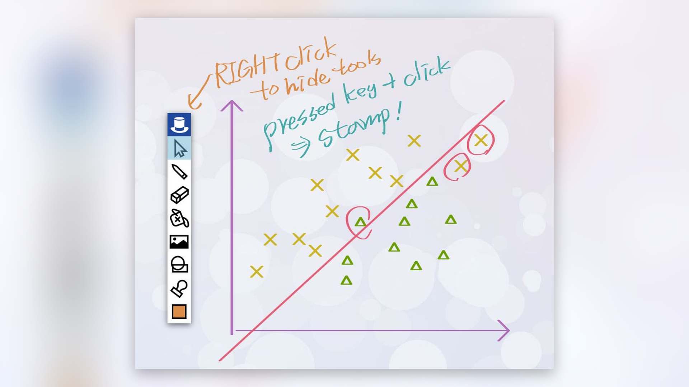
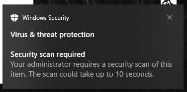
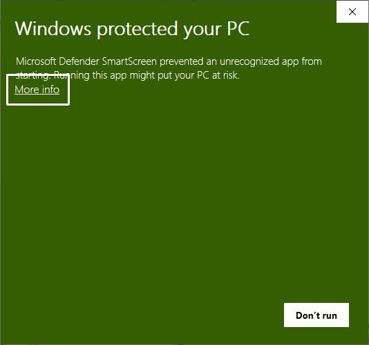
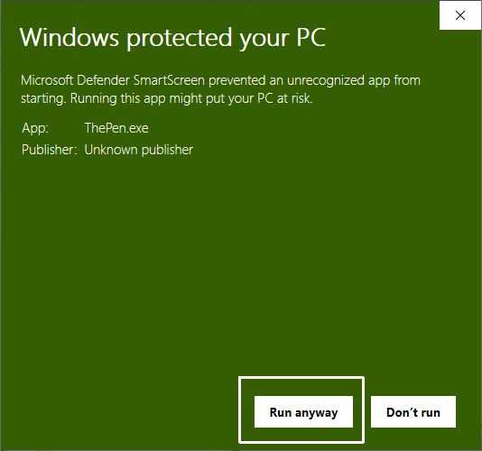
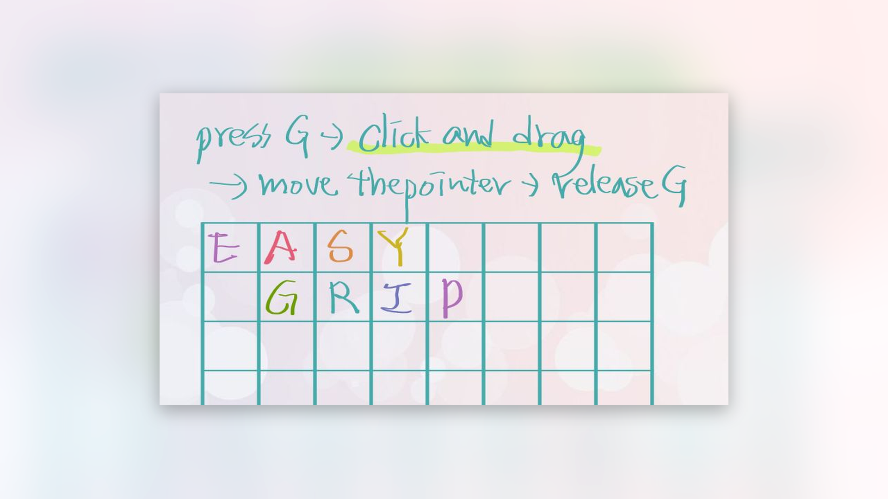
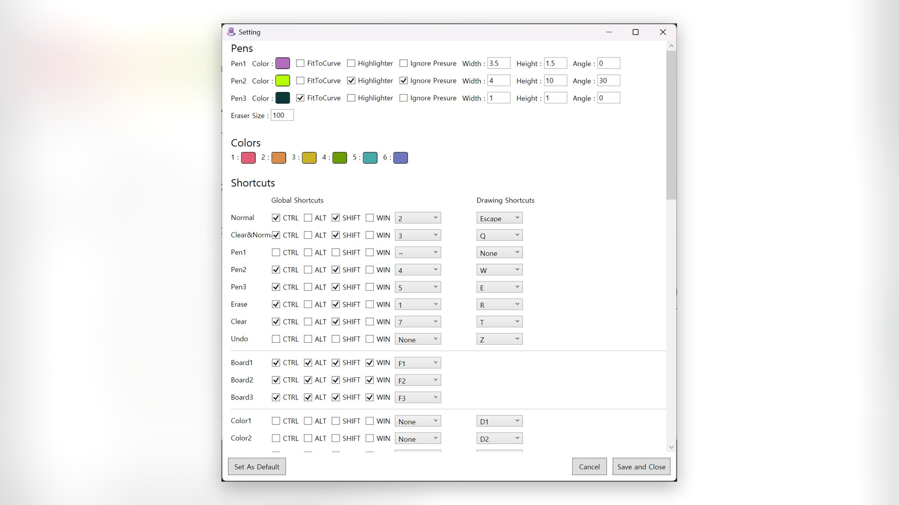
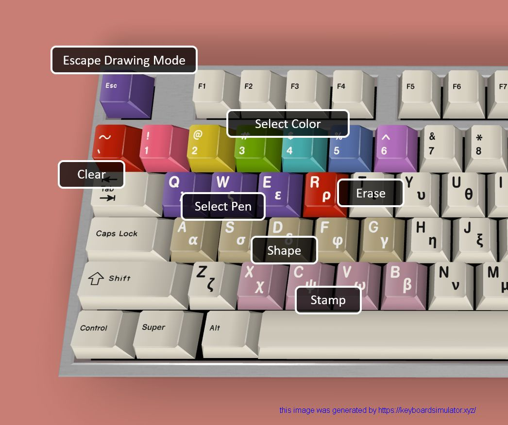
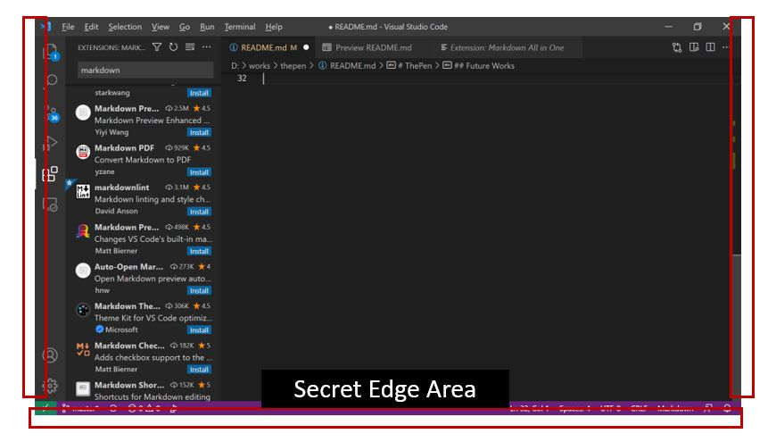

[English](README.md) | **한국어**

# ThePen
ThePen은 Windows 화면 위에 필기하는 프로그램입니다. 제 온라인 강의에 쓰려고 만들기 시작했습니다. 무료이며, 널리 쓰이고 도움이 되기를 바랍니다.

## 내려받기
ThePen은 Microsoft Store에 있습니다. 무료입니다.

 * 스토어 페이지 : https://apps.microsoft.com/detail/9P2S4QXB0ZFX
 * 또는 Microsoft Store 앱에서 "ThePen"을 검색하세요.
 * 스토어판은 Microsoft가 서명하므로 SmartScreen이나 스마트 앱 컨트롤 경고가 없고, 자동으로 업데이트됩니다.

이전 zip 버전 (Alpha12)

 * https://github.com/ladofa/thepen/releases/download/%23thepenalpha/ThePen-alpha12.zip
 * zip 버전은 서명되어 있지 않습니다. Windows SmartScreen 경고가 뜰 수 있고, 추가 정보를 눌러 실행해야 합니다. 스마트 앱 컨트롤이 켜져 있으면 아예 차단될 수 있습니다.

## 스크린샷
| 격자 | 설정 |
|---|---|
|  |  |

## 주요 기능
 * 한 키 단축키 : 키보드 키 하나만 눌러 펜 종류와 색을 바꿉니다.

 
 * 쉬운 전환 : 스타일러스 펜을 들기만 하면 필기 모드로 바뀌고, 마우스를 움직이면 필기 모드에서 빠져나옵니다.
   - 일부 프로그램(Chrome, Edge, VSCode 등) 위에서는 동작하지 않습니다. 이럴 때는 펜을 모니터 가장자리로 옮기면 모드가 바뀝니다. 마우스 포인터를 모자 아이콘에 올려도 됩니다.

   
 * 마우스를 흔들어 필기 전체 지우기.
 * 도형 : 직선, 원, 사각형, 격자 (한 키 단축키 전용)
 * 도장 : 키를 누르기만 하면 도장이 찍힙니다. (한 키 단축키 전용)
 * 화살표 : 자유 곡선이나 도형 끝에 화살표를 붙입니다.
 * 오버레이 - 현재 시각, 문구, 이미지를 표시합니다. (아직 정비되지 않은 기능입니다)
 * 배경과 오버레이 파일(`back1.png`, `overlay1.txt`, ...)은 `문서\ThePen` 폴더 또는 프로그램 폴더에서 읽습니다.
 * 우클릭한 채 움직여 지우기.
 * 색 팔레트 교체 (단축키 : 숫자 키 7(&))
 * 다중 보드 (단축키 : F1, F2, F3)

## 참고한 프로그램
 * Epic Pen : https://epic-pen.com/
 * 판서펜 : https://kinfolksoft.com/%EB%B8%8C%EB%A6%AC%ED%95%91%ED%8E%9Cbriefing-pen-2/

## 도움받은 글
기법을 익히는 데 도움이 된 글입니다. 이 글들의 코드는 이 프로젝트에 들어 있지 않습니다.
 * 저수준 마우스 훅 : https://poorman.tistory.com/297
 * WPF 전역 단축키 : https://social.technet.microsoft.com/wiki/contents/articles/30568.wpf-implementing-global-hot-keys.aspx
 * 제목 표시줄 없는 창 옮기기 : https://gigong.tistory.com/99
 * InkCanvas 실행 취소/다시 실행 : https://stackoverflow.com/questions/6368517
 * 마우스 이벤트 발생시키기 : https://stackoverflow.com/questions/2421304

## 개발 환경
 * WPF C#, .NET 10
 * PixiEditor.ColorPicker (3.4.1) - MIT 라이선스

## 릴리스 노트
[영문 README의 Release Notes](README.md#release-notes)를 참고하세요.

## 라이선스
Copyright (c) 2021-2026 ladofa

ThePen은 무료이며 앞으로도 무료입니다. [PolyForm Noncommercial License 1.0.0](LICENSE.md)을 따릅니다.
 * 비상업적 목적이라면 자유롭게 사용, 수정, 재배포할 수 있습니다.
 * 재배포할 때에는 라이선스와 [NOTICE](NOTICE)의 `Required Notice` 줄을 함께 전달해야 합니다.
 * 추가 허용 : ThePen을 실행하고 사용하는 것은 직장, 유료 강의, 그 밖의 상업 활동을 포함해 어떤 목적으로든 허용됩니다.
 * ThePen을 판매하거나, 사본에 요금을 받거나, 유료로 판매·제공되는 제품이나 서비스에 포함할 수 없습니다.

위 설명은 요약이며, 법적 효력은 영문 라이선스 원문에 있습니다. 제3자 구성 요소와 라이선스는 [THIRD-PARTY-NOTICES.md](THIRD-PARTY-NOTICES.md)에 있습니다.
